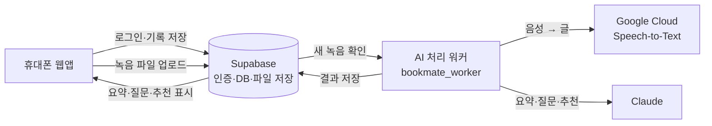

# BOOKMATE

> 독서 모임의 대화를 기록으로 남기는 모바일 웹앱
> 녹음 → AI 요약 → 토론 질문 → 다음 책 추천

친구 넷이 하는 독서 모임에서 쓰려고 직접 만든 앱입니다. 좋은 이야기가 오가도 모임이 끝나면 아무것도 남지 않는 것이 아쉬워서 시작했습니다.

## 왜 만들었나

| 불편했던 점 | BOOKMATE에서 바꾼 것 |
|---|---|
| 모임에서 나눈 이야기가 기록으로 남지 않음 | 모임을 녹음하면 AI가 글로 옮기고 요약 |
| 다음 모임에서 무슨 이야기를 할지 매번 고민 | 책과 지난 대화를 바탕으로 토론 질문 제안 |
| 다음 책을 고르는 데 시간이 오래 걸림 | 멤버들이 적어 둔 독서 취향을 먼저 반영해 책 추천 |
| 각자 읽은 책과 감상이 흩어져 있음 | 개인 서재와 모임 기록을 한곳에 |

## 주요 기능

- **내 서재**: 읽은 책과 읽는 중인 책, 감상 기록
- **모임**: 모임별 책, 일정, 대화 기록
- **모임 녹음과 AI 요약**: 녹음 파일을 올리면 음성 인식 후 핵심 내용을 요약
- **토론 질문**: 책과 모임 대화를 바탕으로 다음에 이야기할 질문 제안
- **책 추천**: 멤버가 적은 독서 취향(예: 한국 에세이, 과학 교양서)을 최우선으로 반영
- **AI 독서 토론**: 혼자 읽을 때 AI와 책에 대해 이야기
- **MY**: 프로필과 독서 취향 설정
- 휴대폰 홈 화면에 추가해 앱처럼 쓸 수 있습니다(PWA).

## 동작 흐름



1. 휴대폰에서 모임을 녹음해 올립니다.
2. AI 처리 워커가 새 녹음을 확인하고 음성을 글로 바꿉니다.
3. 글로 바뀐 대화를 AI가 요약하고, 토론 질문과 책 추천을 만듭니다.
4. 결과가 저장되어 모임 화면에 나타납니다.

## 기술 구성

| 영역 | 사용한 것 |
|---|---|
| 화면 (`bookmate_web/`) | 빌드 과정 없는 HTML·JavaScript 모바일 웹앱(PWA), supabase-js |
| 배포 | Vercel (정적 파일) |
| 로그인·데이터·파일 | Supabase (인증, PostgreSQL, 스토리지, 행 단위 보안 RLS) |
| 데이터 구조 (`supabase_schema.sql`) | 테이블 28개, 접근 규칙, 서버 함수 |
| AI 처리 (`bookmate_worker/`) | Python 워커. Supabase의 작업 대기열을 확인해 처리 |
| 음성 인식 | Google Cloud Speech-to-Text (긴 녹음은 ffmpeg로 나눠 처리) |
| 요약·질문·추천·토론 | Claude |

```
bookmate/
├─ bookmate_web/          화면: index.html, api.js(Supabase 연결), 아이콘, manifest.json
├─ bookmate_worker/       AI 처리 워커: bookmate_worker.py, ai_core.py, .env.example
├─ supabase_schema.sql    데이터베이스 구조와 접근 규칙
└─ BOOKMATE_시작하기.md    설치와 운영 안내
```

AI 처리 워커는 밖으로 나가는 요청만 보냅니다. 그래서 공개 주소 없이 개인 PC에서 켜 둘 수 있고, 꺼져 있는 동안 쌓인 작업은 다시 켜면 이어서 처리합니다. 워커가 꺼져 있어도 서재, 모임, 일정, 토론, 녹음 업로드는 그대로 됩니다.

## 만들면서 바꾼 결정들

처음 계획대로 된 것은 거의 없었습니다. 기준을 "친구들이 실제로 쓸 수 있는가"로 두고 계획을 여러 번 바꿨습니다.

| 처음 계획 | 부딪힌 문제 | 바꾼 방식 |
|---|---|---|
| 외부 서비스 없이 내 PC에서만 동작 | 친구들이 각자 휴대폰으로 쓸 수 없음 | 웹앱으로 배포 |
| 내 PC에 데이터 저장 | PC가 꺼지면 모임 기록을 볼 수 없음 | Supabase에 저장해 기록을 보존 |
| 빠른 음성 인식 | 비용이 커짐 | 느리지만 저렴한 일괄 처리 방식, 월 사용 한도 설정 |
| 탐색 메뉴 포함 | 실제로는 쓰지 않을 기능 | 메뉴에서 삭제 (내 서재 · 모임 · MY) |
| 일반적인 책 추천 | 모임 취향과 맞지 않음 | 멤버가 적은 취향을 최우선 반영 |

테스트에서 1분 녹음을 처리하는 데 약 9분이 걸렸습니다. 요약은 모임이 끝난 뒤에 받아도 충분하다고 판단해, 속도 대신 비용이 적게 드는 방식을 택했습니다.

## AI를 이렇게 썼습니다

- **만드는 과정**: 화면 설계, 데이터 구조, 코드 작성과 오류 수정을 AI와 대화하며 진행했습니다. 무엇을 만들지와 무엇을 뺄지는 직접 정했습니다.
- **앱 안에서**: 음성 인식, 요약, 토론 질문, 책 추천, 독서 토론에 AI를 사용합니다.
- **비용 관리**: AI 사용량에 월 한도를 두어 무료 범위에 가깝게 운영합니다.

## 실행 방법

자세한 순서는 [BOOKMATE_시작하기.md](BOOKMATE_시작하기.md)에 있습니다.

1. **Supabase**: 프로젝트를 만들고 SQL Editor에서 `supabase_schema.sql`을 실행합니다.
2. **화면**: `bookmate_web/api.js` 맨 위의 `SB_URL`, `SB_KEY`를 내 프로젝트 값으로 바꾸고, 폴더를 Vercel 같은 정적 호스팅에 올립니다.
3. **AI 처리 워커**:

```bash
cd bookmate_worker
pip install -r requirements.txt
cp .env.example .env        # 값을 채웁니다
python bookmate_worker.py   # Windows는 run_worker.bat
```

`.env`에 넣는 값(저장소에는 포함하지 않습니다):

| 이름 | 용도 |
|---|---|
| `SUPABASE_URL` | Supabase 프로젝트 주소 |
| `SUPABASE_SECRET_KEY` | 워커에서만 쓰는 관리자 키 |
| `ANTHROPIC_API_KEY`, `ANTHROPIC_MODEL` | 요약·질문·추천·토론 |
| `GCP_PROJECT`, `GCS_BUCKET`, `GOOGLE_APPLICATION_CREDENTIALS` | 음성 인식 |
| `STT_MONTHLY_MIN_LIMIT`, `CHAT_DAILY_LIMIT`, `REC_DAILY_LIMIT` | 사용량 한도 (기본 100분 / 10회 / 5회) |
| `STT_MODE` | `batch`(저렴, 느림) 또는 `fast` |
| `RETENTION_DAYS` | 원본 녹음을 자동 삭제하는 기간 (기본 30일) |

## 개인정보와 보안

- 독서 모임 멤버 4명이 쓰는 비공개 앱입니다. 멤버 가입이 끝나면 신규 가입을 닫아 운영합니다.
- API 키, 녹음 파일, 모임 대화 내용은 이 저장소에 없습니다.
- 데이터는 로그인한 멤버만 볼 수 있도록 행 단위 보안(RLS)을 적용했습니다.
- 원본 녹음은 일정 기간 뒤 자동으로 지우고, 대화 기록과 요약만 남깁니다.
- 이 저장소의 `api.js`와 `.env.example`에는 실제 프로젝트 값 대신 자리표시자가 들어 있습니다. 운영 중인 앱 주소도 공개하지 않습니다.

## 한계와 다음 단계

- AI 처리 워커가 제 PC에서 돌아가서, PC가 꺼져 있으면 요약이 늦어집니다. → 서버로 옮기기
- 음성 인식이 느립니다(1분 녹음에 약 9분). → 비용을 유지하면서 속도를 높일 방법 찾기
- 자동 테스트가 없습니다. → 핵심 기능부터 테스트 추가

## 만든 사람

Sujee Cho · [github.com/sujee5947-create](https://github.com/sujee5947-create)
